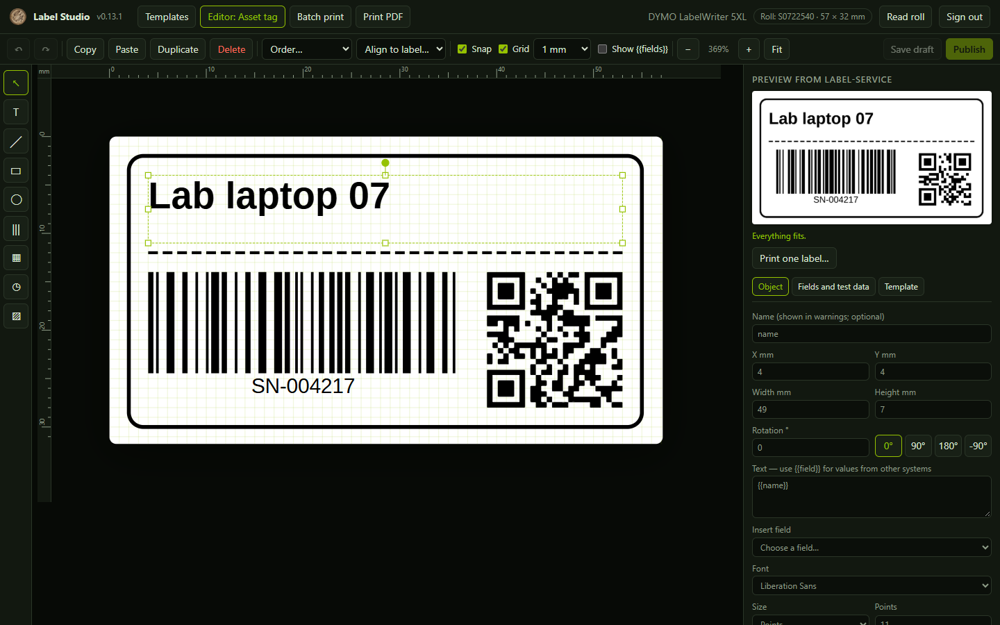
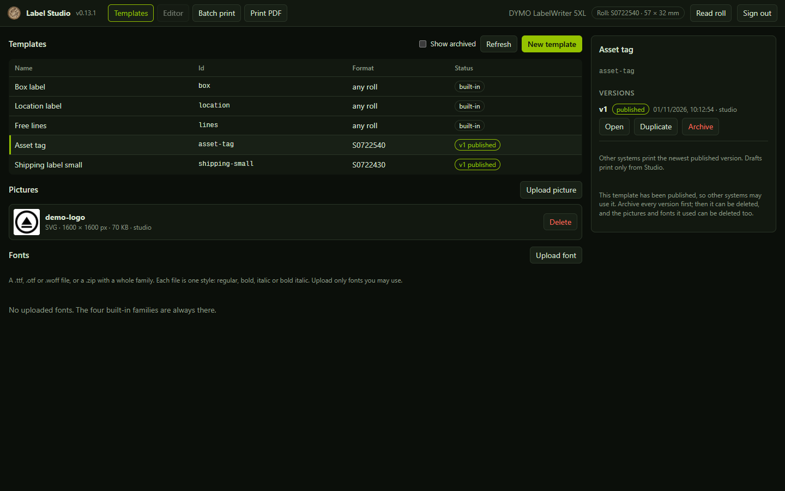
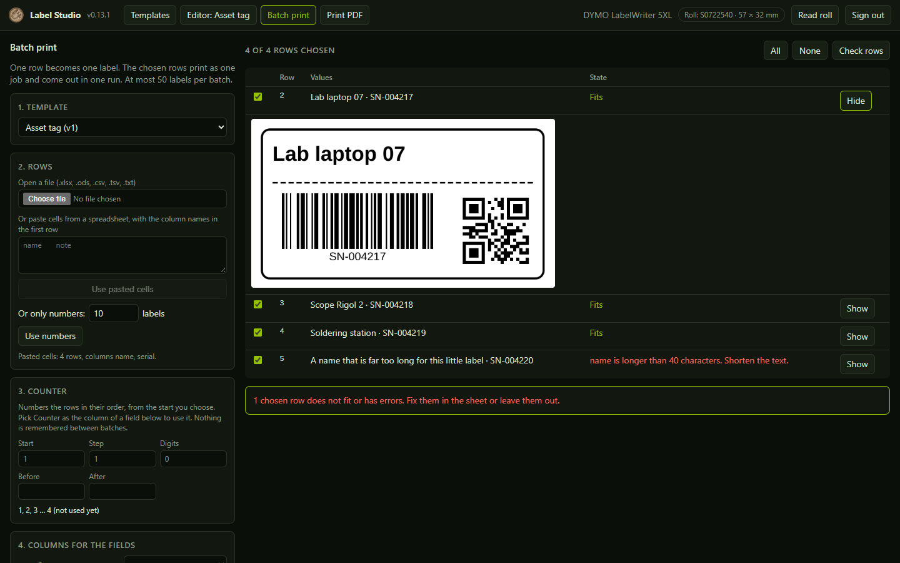
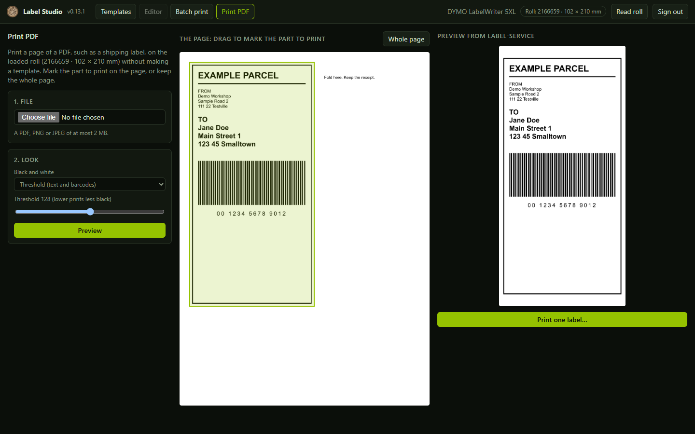

# Label Studio

A web app for designing label templates for label-service, the LAN print service for DYMO LabelWriter printers. You draw a template on a label to scale, give it named fields (`{{recipient}}`), check it against label-service's own rendering and publish it. Other systems then print it by its id with their own field values.

Status: `VERSION` 0.13.1, in daily use. Needs [label-service](https://github.com/Snille/label-service) 0.16.0 or later. See the [history](docs/HISTORY.md) and the first design report in [docs/forstudie.md](docs/forstudie.md) (Swedish).



| Template library | Batch print from a sheet | Print a part of a PDF |
| --- | --- | --- |
|  |  |  |

The screenshots come from the local test stack below, with made-up data and no printer.

## How it fits

Label Studio never talks to a printer. label-service owns the templates, the rendering and the printers; Studio is an editor on top of its API, with its own client key (role `designer`). The Studio server serves the app and forwards only the template, preview, job and roll-reading calls to label-service; settings, rolls, printers and the raw roll readings stay on the label-service admin page.

```
browser (Studio key) ─▶ Label Studio server :3231 ─▶ label-service API :3230 ─▶ CUPS ─▶ printer
```

## What it does

- **Editor:** the label to scale with rulers, a millimetre grid and snapping to the grid, the label's edges and centre, and other objects. Objects: text, line, rectangle, ellipse, barcode (Code 128, Code 39, EAN-13, EAN-8, UPC-A, ITF-14), QR and Data Matrix code, date, and picture. The canvas draws barcodes as stand-ins that follow the data and the box; the preview shows the real code. Rotate any object with the round handle above it (it snaps near every 15°; Shift keeps to 15° steps, Alt turns freely) or type the angle; buttons set 0°, 90°, 180° and -90°. Move and resize with the mouse or keys, copy, paste, duplicate, delete, undo and redo, layer order, align to the label or to each other.
- **Properties:** position and size in millimetres; text with fields, font (the four families label-service ships and the uploaded ones), size in points or a format size (`$titleSize`), shrink-to size, alignment, bold, italic, wrapping, white text; line width, dashes, fill and corner radius for shapes; barcode type, data with fields, text under the bars, QR error correction; date format (`yyyy`, `yy`, `MM`, `dd`, `HH`, `mm`) with text before and after; for pictures the uploaded picture, keep proportions or stretch, threshold (logos) or dithering (photos), the threshold level, lightening for thermal paper (dots print larger than on screen) and invert. The template panel sets the print density (light to dark). The canvas shows the picture in grey; the preview shows the black and white dots that print.
- **Any roll:** a template can be made for every roll. Tick Any roll in the template panel: it is drawn on one roll, and saving writes `media: ["*"]` with every position and size as a share of the label (`"12.5%"`), so the objects follow the size of each roll. Font sizes, line widths and corner radii stay as they are; give text a shrink-to size for small rolls.
- **Fields and test data:** a `{{name}}` in a text or in barcode data creates a field. Each field has a test value that is saved with the template.
- **Preview:** half a second after each change, label-service renders the label as a PNG with the test values. Objects that do not fit are named in the warnings and outlined on the canvas.
- **Rolls and margins:** the rolls come from label-service, including those added on its admin page (decision B11). A new roll shows up once its test print is approved there (B12). Its edges that do not print, measured on that test print, are shaded red on the canvas, and the preview warns about an object that reaches into them.
- **Fonts:** upload a `.ttf`, `.otf` or `.woff` file, or a `.zip` with a whole family, in the library. Each file is one style (regular, bold, italic, bold italic), read from the font itself; label-service keeps it and draws it like the built-in fonts. The editor loads the uploaded fonts into the page, the font menu marks them, and Bold and Italic are off for a style the family lacks. A font that no saved template uses can be deleted. Upload only fonts you may use; a font whose maker allows no embedding is marked.
- **Read roll:** the button in the header asks label-service to read the roll in the printer. A known roll becomes the printer's format at once; an unknown one is added on the label-service admin page. Press it after a roll change, while nothing prints. Nothing reads the roll on its own.
- **Built-in labels:** box, location and lines are edited like any template. A saved version keeps the label's fields and stays for any roll, because other systems print it by its id; the published version replaces the original, and archiving every version brings the original back. Their text direction can follow each roll, and their text sizes can stay the format sizes (`$titleSize` and the others) saved in label-service.
- **Template library:** built-in and saved templates, versions with their status, open, duplicate, publish, archive. A template whose every version is archived is hidden until you tick Show archived. A template that was never published, or whose every version is archived, can be deleted with all its versions; that also frees the pictures and fonts it used. A published one must be archived first, because other systems may use it.
- **Pictures:** upload PNG, JPEG or SVG (at most 2 MB) in the library or from an image object; the library lists them with a thumbnail and deletes a picture that no saved template uses. Saving always adds a new draft version. Other systems print the newest published version.
- **Print one label:** with the test values, after a confirmation that names the printer and the roll. A fresh preview and a new request id are made for each print, so label-service's guards apply unchanged.
- **Batch print:** a published template (or the built-in box and location labels) filled from a sheet, one row per label. Open a `.xlsx`, `.ods`, `.csv`, `.tsv` or `.txt` file, or paste cells copied from a spreadsheet; the first row holds the column names, and only the first sheet is read. Old `.xls` files must be saved as `.xlsx` first. Columns are matched to fields by name or label and can be changed. Check rows asks label-service about every row without a print token, lists the rows that do not fit, and shows any row as label-service renders it. Rows can be left out. The chosen rows print as one job, one page per label, so the printer runs them in one go as DYMO Connect does (decision B8, changed 2026-10-27: the DYMO driver needs about 10 seconds between jobs). At most `batchLimit` labels go in one batch (label-service settings, 50 by default). The job's request id is kept in the browser per batch (same template version, same rows), so the same batch is not sent twice without a warning. If the printer stops in the middle, check the roll, leave out the rows that came out and print again. Numbers keep a decimal point, and dates become `yyyy-MM-dd` (with `HH:mm` when there is a time).
- **Print PDF:** print a page of a PDF (a shipping label, for example), or a PNG or JPEG, on the loaded roll without a template. Choose the file and the page, drag on the page to mark the part to print (or keep the whole page), choose threshold or dithering, preview and print one label. The page is turned a quarter when that makes it larger on the label and is kept in proportion with a 1 mm margin. The pictures made for this are deleted when you press Done or leave the view; any that are left show in the picture list as "Print PDF: …".
- **Pictures from PDF:** the picture upload in the library and the editor also takes the first page of a PDF.
- **Counter (serial numbers):** in a batch, any field can take the Counter instead of a column: the rows are numbered in their order from a start you choose, with a step, a number of digits (`0098`) and text before and after (`SNI-0098`). A field named counter, serial, number or nr takes it by itself. For labels that need nothing but a number, Only numbers makes a run of empty rows to count. Nothing is remembered between batches: choose the start each time (the owner's choice; a counter kept by label-service would need a new database schema).

The editor draws text with the browser and the same fonts, so it is close to the result but not exact. The label-service preview is the truth.

Keys in the editor: `V` select, `T` text, `L` line, `R` rectangle, `E` ellipse, `B` barcode, `Q` QR code, `D` date, `I` picture; arrows move one grid step, Shift+arrows 0.1 mm, Ctrl+arrows resize; Ctrl+C, Ctrl+V, Ctrl+X, Ctrl+D, Ctrl+A, Delete, Ctrl+Z, Ctrl+Y, Ctrl+S; Alt while dragging turns snapping off; Shift on a corner keeps the proportions; Ctrl+wheel zooms.

## Limits in this version

- Templates are edited in millimetres on one roll. A template for one roll that used percentages or `right`/`bottom` is saved in millimetres; an any-roll template is saved in percentages of the roll it was drawn on.
- The preview needs the template's roll in the chosen printer, because label-service renders on the loaded roll.
- The interface is in English only.
- Barcodes, QR codes and dates need label-service 0.6.0 or later; deleting templates needs 0.7.0; pictures need 0.8.0; lightening and print density need 0.9.0; batch printing and rotation need 0.11.0; PDF pages and the new barcode types need 0.12.0; rolls added on the admin page and their margins need 0.13.0; uploaded fonts need 0.14.0.

## MCP server

Label Studio is also an MCP server for LLM clients such as Claude, at `/mcp` (Streamable HTTP; one JSON-RPC message per POST, answered as JSON). The client sends its own label-service key as a bearer token, normally a key with the `drafter` role; Label Studio passes it on and stores no key. LLMs propose, people publish: a drafter can preview and save drafts but not publish, and prints only published templates.

| Tool | What it does |
| --- | --- |
| `list_media` | Printers, the loaded roll and its size in mm, the formats. |
| `get_design_guide` | The template format and good practice (also the resource `label-studio://design-guide`). |
| `list_templates`, `get_template` | Saved and built-in templates, one with its definition. |
| `preview_label` | A saved template or an unsaved definition with fields → PNG, `fits`, warnings per object, a preview token. |
| `save_template_draft` | A new draft version for a person to publish in Label Studio. |
| `list_assets`, `upload_asset` | Pictures for image objects. |
| `print_label` | One physical label from a preview token; the tool tells the client to ask the user first. |
| `job_status` | A print request's journal record and queue state. |

Add the key to label-service (`LABEL_CLIENT_KEYS=...,mcp=<key>`, `LABEL_CLIENT_ROLES=...,mcp=drafter`) and register the server in the client, for Claude Code:

```
claude mcp add --transport http label-studio http://<studio host>:3231/mcp --header "Authorization: Bearer <mcp key>"
```

A browser page from another site cannot call `/mcp` (its Origin is refused).

## Sign-in

Label Studio asks for its key once and keeps it in the browser's local storage (decision B13: LAN only, no user accounts). It accepts only a key with the `designer` role. Configure the key in label-service:

```
LABEL_CLIENT_KEYS=storagesystem=<key>,studio=<long random key>
LABEL_CLIENT_ROLES=studio=designer
```

## Run locally

Development, against a label-service on `127.0.0.1:3230` (or set `LABEL_SERVICE_URL`):

```powershell
npm ci
npm run dev          # http://localhost:5173
```

A complete test stack in Docker Desktop with a label-service that has no printer (nothing can print), using the development keys in [compose.yaml](compose.yaml):

```powershell
docker compose up -d --build   # Studio on http://127.0.0.1:3231
docker compose down -v
```

## Configuration

| Variable | Meaning |
| --- | --- |
| `LABEL_SERVICE_URL` | label-service origin, for example `http://api:3230` inside the stack. Required. |
| `PORT`, `HOST` | Listen address, default `3231` on `127.0.0.1` (`0.0.0.0` in the image). |
| `LABEL_SERVICE_TIMEOUT_MS` | How long a forwarded call may take, default 150000 (a print may wait for the printer's queue). |

## Deploy

Label Studio runs as its own container in the label-service stack (decision B3). The `studio` service is already in label-service's [compose.portainer.yaml](https://github.com/Snille/label-service/blob/main/compose.portainer.yaml): add `studio=<key>` to `LABEL_CLIENT_KEYS` and `studio=designer` to `LABEL_CLIENT_ROLES`, and publish port 3231 on the LAN only. Set `LABEL_STUDIO_IMAGE` to pin another tag or digest. The published image is `mrsnille/label-studio` on Docker Hub (`linux/amd64`), tagged with the version and `latest`.

Label Studio has no user accounts. Anyone who can reach port 3231 and has the Studio key can publish templates and print, so never expose it to the internet.

Release: bump `VERSION`, add a history entry, run the checks, then build and push the image:

```powershell
$v = Get-Content VERSION
docker buildx build --platform linux/amd64 -t mrsnille/label-studio:$v -t mrsnille/label-studio:latest --push .
```

## Checks

```powershell
npm ci
npm run check        # syntax, unit tests, production build, git whitespace
```

The Docker build runs the unit tests again. Label Studio stores no data of its own; templates live in label-service.

## Licences

Label Studio is under the [MIT License](LICENSE). The fonts in `public/fonts` are the ones label-service renders with: Liberation (SIL Open Font License 1.1) and DejaVu (free licence); their licence files are next to them.
