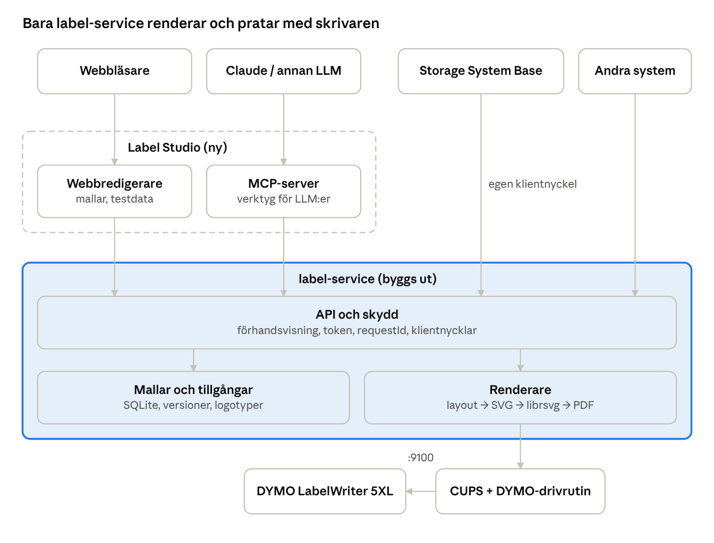

# Label Studio – förstudie

2026-10-25 · Erik Pettersson · Levande version: [Label Studio – förstudie](https://claude.ai/artifact/1bSHwWtT4FHEJ9EFH1bD62)

## Sammanfattning

Label Studio blir en webbapp där man ritar egna etikettmallar för rullarna i DYMO LabelWriter 5XL, och där andra system och LLM:er sedan fyller i fälten och skriver ut via label-service. label-service gör redan det svåra rätt: en enda väg till skrivaren, förhandsgranskning före utskrift, inga dubbletter. Men den kan i dag bara skriva **text** i tre fasta mallar (`box`, `location`, `lines`). För en riktig designer behöver den kunna rita fritt placerade objekt: text, streckkod, QR-kod, bild, linje och form.

De tre största besluten:

1. **Var renderingen sker.** Förslag: label-service blir ensam om att rendera, och Studio visar samma rendering som förhandsvisning. Då ser etiketten likadan ut i alla appar.
2. **Mallformatet.** Förslag: ett eget JSON-format med objekt i millimeter och namngivna fält (`{{namn}}`). Det är lätt för både webbappen och en LLM att skriva.
3. **Var Studio och MCP bor.** Förslag: Studio som en egen app (`label-studio`) som pratar med label-service via API, och MCP-servern i Studio.

Alla punkter att ta ställning till finns i avsnittet **Beslutspunkter**.

## DYMO Connect for Desktop: funktioner

DYMO Connect har nio objekttyper, mallar per användning, dataimport för serieutskrift och rullavläsning. Listan bygger på DYMO:s användarguide (reviderad 10/2026), eftersom hjälpartikeln inte gick att läsa maskinellt. Kolumnen *Studio* är mitt förslag: **MVP** = första versionen, **Senare** = fas 2+, **Nej** = hoppa över.

### Objekt på etiketten

| Objekt | Vad DYMO kan | Studio |
| --- | --- | --- |
| Text | Typsnitt, storlek eller *Auto fit*, fet/kursiv/understruken, vänster/mitten/höger, topp/mitten/botten, rotation, textfärg, bakgrund, ram | MVP |
| Streckkod | Code 39, Code 128, Interleaved 2 of 5, UPC, EAN, GS1-128, ITF-14, Codabar, GS1 DataMatrix, PDF417, POSTNET/PLANET/Intelligent Mail; text ovanför eller under | MVP (Code 128, EAN-13, DataMatrix), resten Senare, US-post Nej |
| QR-kod | Text, URL, telefon, e-post, SMS, vCard; storlek auto | MVP (text/URL), resten Senare |
| Bild | BMP, GIF, PNG, JPG, TIF; urklipp, skärmklipp, kamera, clipart, logotyp; *Fill* eller *Stretch*; PDF-sida som bild | MVP (PNG/JPG/SVG, fill/stretch), PDF-import Senare |
| Form | Rektangel, kvadrat, cirkel, ellips, triangel; linjefärg, fyllning, linjestil, linjebredd | MVP |
| Linje | Vågrät, lodrät, diagonal; färg, stil, bredd | MVP |
| Datum och tid | Aktuellt datum och/eller tid vid utskrift, format, text före/efter | MVP |
| Räknare | Startvärde, steg, inledande nollor, prefix/suffix; antal etiketter vid utskrift | Senare |
| Adress | Text med kontakter från Outlook/Google/Apple, US-adressfix | Nej (ersätts av fält från andra system) |

### Arbetsyta och redigering

- Markera ett eller flera objekt (Ctrl+klick), välj objekt som ligger under andra.
- Flytta, ändra storlek med handtag (hörn = proportionellt), kopiera, klistra in, ta bort.
- Justera objekt mot varandra eller mot etikettens kant.
- Lagerordning: framåt, bakåt, längst fram, längst bak.
- Namnge objekt (används av DYMO:s SDK för att fylla i data).
- Ram runt ett objekt eller runt hela etiketten.
- Tangentbordsstyrning: flytta och ändra storlek med Ctrl+pilar.

### Mallar och filer

- *Simple*-etikett (en textruta, liggande eller stående), tom etikett, och färdiga mallar per användning: adress, prislapp, mapp, frakt, streckkod, förvaring/hylla, namnbricka, media.
- Mallar kan inte ändras, bara användas som start. Egna etiketter sparas som fil, med *Senaste* och *Favoriter*.
- Bara mallar som passar vald skrivare och rulle visas.

### Data och serieutskrift

- Import från Excel, CSV/TXT, Access och UDL, samt Outlook- och Google-kontakter.
- Koppla fält till text-, streckkods- och QR-objekt; flera fält plus fast text i samma objekt.
- En etikett per rad; *Skriv ut*-knappen visar antalet. Visa data, men inte ändra den.
- Kontaktlistor som sparas i programmet.

### Skrivare och rullar

- Automatisk rullavläsning (*Automatic Roll Recognition*) på LabelWriter 5-serien.
- Varning när etiketten inte matchar rullen; objekten skalas om vid byte av rulle.
- Nätverksskrivare läggs till per dator, och programmet måste installeras på varje dator.
- Tillägg för Word och Excel, och ett SDK för utvecklare.

Det sista är just det Label Studio löser: ingen installation per dator, och bara label-service pratar med skrivaren.

## label-service i dag (0.4.1)

label-service är en liten Node 24-tjänst utan externa paket, plus en CUPS-container med DYMO:s drivrutin. Den körs live på LAN och är ensam om skrivaren (adresserna finns i Eriks anteckningar, inte i repot). Det här finns och ska behållas:

| Del | Vad den gör i dag |
| --- | --- |
| API | `GET /formats`, `/status`, `/templates`; `POST /previews` ger token + SVG; `POST /jobs` skriver ut en kopia; `GET /jobs`; admin: `/settings`, `/roll` |
| Skydd | Förhandsgranskning krävs, token gäller 10 min och en gång, överflöd stoppar utskrift, `requestId` stoppar dubbletter, `unknown` utan nytt försök, varje klient ser bara sina jobb |
| Klienter | En nyckel per system (`LABEL_CLIENT_KEYS`), admin-nyckel; CORS bara via `LABEL_ALLOWED_ORIGINS` |
| Rullar | Fem fasta format i koden: S0722540 (57×32), S0722550 (19×51), S0722520 (25×54), S0722430 (54×101), 2166659 (102×210 mm). Vald rulle ställs in av admin; rullavläsning på begäran |
| Mallar | `box` (titel, beskrivning, plats), `location` (stor plats), `lines` (1–12 fria rader) – alla hårdkodade i `src/labels.js` |
| Layout | Egen ordbrytning och krympning, centrerad text, stående eller liggande |
| Rendering | Egen PostScript-generator (Helvetica och Helvetica-Bold, Latin-1) till CUPS; SVG bara för förhandsvisning |
| Lagring | SQLite: inställningar och jobbjournal. Förhandsvisningar ligger bara i minnet |

README säger redan att en "label designer" ska lägga sparade mallar med egna fält i samma `kind`-modell. Det är alltså planerat från början.

## Luckor i label-service

Den största luckan är renderingen: PostScript-generatorn kan bara skriva centrerade textrader i Helvetica. Allt annat i en designer bygger på att den byts eller byggs ut. Luckorna i ordning efter hur mycket de blockerar:

| # | Lucka | Varför det behövs | Storlek |
| --- | --- | --- | --- |
| L1 | Generell renderare: fritt placerade objekt (x, y, bredd, höjd, rotation) i stället för tre fasta layouter | Grunden för all design | Stor |
| L2 | Sparade mallar: skapa, läsa, ändra, versioner, arkivera (SQLite-tabell + API) | Andra system ska kunna skriva ut "fraktetikett v3" med sina fält | Medel |
| L3 | Streckkod och QR-kod (Code 128, EAN-13, QR, DataMatrix) | Vanligaste behovet efter text | Medel |
| L4 | Bilder: lagring av logotyper, 1-bit-omvandling (dithering) för termoskrivaren | Logotyper, symboler | Medel |
| L5 | Fler typsnitt och tecken utanför Latin-1 (till exempel →, °, Ω, €) | Dagens PostScript-väg klarar bara Latin-1 och standardtypsnitt | Beror på renderingsval |
| L6 | Exakta typsnittsmått | Dagens bredder är uppskattade per tecken; en designer måste veta exakt om text får plats | Liten–medel |
| L7 | Överflöd per objekt i svaret (`warnings: [{object, reason}]`) | Studio och LLM:er måste veta *vad* som inte får plats | Liten |
| L8 | Serieutskrift: flera etiketter (CSV-rader, räknare) i ett anrop | Dagens regel är en kopia per jobb | Medel, berör skydden |
| L9 | Utskriftsbar yta och marginaler per rulle | Objekt nära kanten skrivs inte ut | Liten |
| L10 | Fler rullar utan ny version (admin lägger till format) | Dagens fem format är hårdkodade i `src/label-media.js` | Liten–medel |
| L11 | Större anrop: 64 KB räcker inte för bilder | Bilder bör laddas upp separat och refereras med id | Liten |
| L12 | Förhandsvisning som PNG (inte bara SVG) | MCP-klienter visar bilder, inte SVG | Liten |
| L13 | Behörighet per mall och klient (vem får skapa, vem får skriva ut) | Studio, MCP och vanliga klienter behöver olika rättigheter | Liten |

Skydden (förhandsgranskning, en token per jobb, `requestId`, `unknown` utan nytt försök) ska gälla oförändrat för de nya mallarna.

## Förslag på arkitektur

label-service äger mallarna och renderingen; Label Studio är bara en redigerare och en MCP-server ovanpå dess API. Då skriver alla system, Studio och LLM:er ut exakt samma etikett, och skydden finns på ett ställe.



Alla vägar till skrivaren går genom label-service API, och Studio och MCP är klienter med egna nycklar precis som Storage System Base.

### Rendering: en SVG är sanningen

I dag finns två renderingar (SVG för visning, PostScript för utskrift) som kan glida isär. Förslaget är att label-service bygger **en** SVG per etikett, och att samma SVG blir utskrift:

1. Mall + fältdata → layout (mäter text med riktiga typsnittsmått, kollar överflöd per objekt).
2. Layout → SVG med inbäddade typsnitt; streckkoder och QR som rena rektanglar.
3. SVG → PDF eller 300 dpi-raster med `librsvg` (`rsvg-convert`, ett apt-paket i containern, inget npm-paket) → CUPS.
4. Samma SVG (eller en PNG av den) skickas till Studio och MCP som förhandsvisning.

Det löser L1, L5, L6 och L12 på en gång. Alternativet är att bygga ut dagens PostScript-generator; det håller tjänsten helt utan beroenden men låser typsnitt till Latin-1 och PostScript-standardtypsnitten.

### Mallformat (utkast)

Mått i millimeter, origo uppe till vänster på läsbar yta, fält med `{{namn}}`. Mallen är knuten till en eller flera rullar.

```json
{
  "id": "shipping-small", "version": 3, "name": "Fraktetikett liten",
  "media": ["w154h286"], "orientation": "portrait",
  "fields": {
    "recipient": { "type": "text", "required": true, "maxLength": 200 },
    "orderNo":   { "type": "text", "pattern": "^[0-9]{6,10}$" }
  },
  "objects": [
    { "type": "image",   "x": 2, "y": 2,  "w": 20, "h": 10, "asset": "logo-company", "fit": "contain" },
    { "type": "text",    "x": 2, "y": 14, "w": 50, "h": 30, "text": "{{recipient}}", "font": "Inter", "size": 11, "autoFit": { "min": 7 }, "align": "left", "valign": "top" },
    { "type": "line",    "x": 2, "y": 46, "w": 50, "h": 0, "stroke": 0.3 },
    { "type": "barcode", "x": 2, "y": 50, "w": 50, "h": 15, "symbology": "code128", "data": "{{orderNo}}", "humanReadable": "below" },
    { "type": "date",    "x": 2, "y": 68, "w": 50, "h": 5, "format": "yyyy-MM-dd", "size": 7 }
  ]
}
```

De tre gamla mallarna (`box`, `location`, `lines`) kan antingen ligga kvar som de är, eller skrivas om i det nya formatet så att det bara finns en väg. Storage System Base fortsätter att anropa samma `POST /previews` och märker ingen skillnad.

### Flera skrivare

label-service ska kunna ha fler än en DYMO-skrivare, även av andra modeller. I dag finns bara en skrivare, men datamodellen byggs för flera från fas 0:

- **Skrivare** blir en egen post: namn, modell, adress, CUPS-kö, drivrutin, upplösning (dpi) och vad den klarar (till exempel rullavläsning).
- **Rullar** hör till en skrivarmodell. Varje skrivare har sin egen valda rulle.
- **Mallar** hör till en rulle, inte till en skrivare. En mall för 54 × 101 mm fungerar på alla skrivare som har den rullen.
- **Jobb** går till en vald skrivare, eller till den skrivare som har rätt rulle i. Varje skrivare har sin egen kö och sitt eget lås, så regeln "en enda väg till skrivaren" gäller per skrivare.
- **Drivrutiner:** LabelWriter 550, 550 Turbo och 5XL använder samma drivrutin som i dag. LabelWriter 450/4XL använder en annan drivrutin, och LabelManager-tejpskrivare (D1) är en helt annan typ. En ny modell kan behöva en ny drivrutin i CUPS-containern, och en provutskrift innan den tas i bruk.
- Admin lägger till och tar bort skrivare i label-service admin.
- **Modeller att stödja:** LabelWriter 550, 550 Turbo och 5XL (de som säljs nya i dag) samt LabelWriter 450 och 4XL (en vän har en 450, så den kan provas på riktigt). Drivrutinen för 450/4XL läggs i CUPS-containern redan i fas 0.
- **Anslutning:** 5XL och 550 Turbo har nätverk. 550, 450 och 4XL har bara USB, så de måste kopplas till datorn som kör label-service (USB in i containern) eller till en USB-skrivarserver. Rullavläsning finns bara på 550-serien och 5XL.

### Label Studio (webbappen)

- Canvas-redigerare i webbläsaren som visar etiketten i skala, med linjaler, rutnät och fäst mot kanter och andra objekt.
- Objektpanel och egenskapspanel som i DYMO; Ctrl+pilar, kopiera/klistra in, ångra/gör om, lagerordning, justera och fördela.
- Testdata per mall: fyll i fälten och se label-service förhandsvisning direkt.
- Mallbibliotek: lista, sök, versioner, duplicera, arkivera; tillgångar (logotyper).
- Mörkt läge som standard, ljust läge finns. Engelska som standard, svenska som tillval. Ikoner finns redan i `label-studio/icons/` (favicon 16/32/48, `favicon.ico`, `apple-touch-icon.png`, 192 och 512 px för en webbapp-manifest) och används i appen.
- Inloggning: en egen Studio-nyckel mot label-service (inte admin-nyckeln i webbläsaren).

## MCP-stöd

Ja, det går bra: eftersom mallen är JSON och förhandsvisningen kan bli en PNG, kan en LLM skriva en mall, titta på resultatet och rätta sig själv. Förslaget är en MCP-server i Label Studio, via Streamable HTTP på LAN, med en egen klientnyckel (`mcp`) mot label-service.

| Verktyg | Vad det gör | Ändrar något? |
| --- | --- | --- |
| `list_media` | Rullar, vald rulle, storlek och utskriftsbar yta i mm | Nej |
| `get_design_guide` | Mallformatet, typsnitt, streckkodstyper, regler och exempel (också som MCP-resurs) | Nej |
| `list_templates`, `get_template` | Sparade mallar och deras fält | Nej |
| `validate_template` | Kollar JSON, fält och överflöd per objekt utan att spara | Nej |
| `preview_label` | Mall (sparad eller inline) + fält → PNG, varningar och preview-token | Nej |
| `save_template_draft` | Sparar ett utkast; en människa publicerar i Studio | Ja (utkast) |
| `list_assets`, `upload_asset` | Logotyper och bilder | Ja |
| `print_label` | Token + `requestId` → ett jobb, samma skydd som i dag | Ja (papper) |
| `job_status` | Status för ett jobb | Nej |

Två principer:

- **LLM:er föreslår, människor publicerar.** En LLM sparar bara utkast. En mall som andra system använder ändras inte av en LLM utan att någon godkänner den i Studio.
- **Varningarna måste gå att agera på.** "Objekt `recipient` får inte plats: 3 rader behövs, 2 ryms vid 7 pt" i stället för bara `printable: false`.

## Beslutspunkter

Tretton frågor att ta ställning till innan koden skrivs; B1–B4 styr resten. Fyll i kolumnen *Beslut* när vi gått igenom en punkt.

| # | Fråga | Alternativ | Mitt förslag | Beslut |
| --- | --- | --- | --- | --- |
| B1 | Hur renderas etiketten? | A: en SVG → `librsvg` → CUPS. B: bygg ut dagens PostScript | A: samma bild i visning och utskrift, alla typsnitt och Unicode. Godkänd på villkor att SVG klarar minst det PostScript klarar | Godkänd |
| B2 | Var lagras mallarna? | A: i label-service (SQLite). B: i Studio | A: alla klienter hämtar mallar från samma ställe som skriver ut | Godkänd |
| B3 | Var bor Studio? | A: eget repo och egen container i samma Portainer-stack. B: inbyggd i label-service `web/` | A: label-service förblir liten och säker, Studio kan ha ett ramverk | Godkänd |
| B4 | Var bor MCP-servern? | A: i Studio. B: i label-service | A: MCP är en klient bland andra, med egen nyckel | Godkänd |
| B5 | Får label-service ha npm-paket (i dag noll)? | A: ett fåtal granskade, låsta paket (till exempel `bwip-js` för streckkoder). B: allt egen kod | A: streckkoder och QR är lätt att göra fel i; ett välkänt bibliotek är säkrare | Godkänd |
| B6 | Ramverk för Studio? | A: Svelte + Vite, redigering direkt i SVG. B: React + canvas-bibliotek (Konva) | A: redigeraren ritar samma SVG som renderaren | Godkänd |
| B7 | Vad händer med `box`, `location`, `lines`? | A: skrivs om i nya formatet, API:t oförändrat. B: ligger kvar som egen kod | A: en enda layoutmotor att testa | Godkänd |
| B8 | Serieutskrift (CSV, räknare)? | A: ett jobb per etikett, var och en med eget `requestId`, max antal per batch. B: ett jobb med många sidor | A: dagens skydd gäller per etikett; en Excel-rad blir en etikett och ett jobb | Ändrad 2026-10-27 till B: DYMO-drivrutinen kräver cirka 10 s paus mellan jobb men skriver ut sidorna i ett jobb i ett svep, som DYMO Connect. Dubblettskyddet gäller hela batchen |
| B9 | Får MCP skriva ut? | A: ja, bara publicerade mallar. B: bara förhandsvisa och spara utkast | A, men MCP-klienten frågar användaren före varje utskrift | Godkänd |
| B10 | Vilka typsnitt? | A: 3–4 öppna typsnitt i containern (sans, smal sans, mono, serif). B: ladda upp egna | A först, B senare | Godkänd |
| B11 | Hur läggs nya rullar till? | A: admin lägger till format (mått, CUPS-namn) i Studio. B: som i dag, i koden | A: Studio ska kunna lägga till både nya mallar och nya rullar; rullar bara av admin, med en provutskrift | Godkänd |
| B12 | Utskriftsbar yta per rulle? | A: mät med en provetikett per rulle. B: anta 1,5 mm marginal | A: kräver fem provutskrifter som du godkänner | Godkänd |
| B13 | Inloggning i Studio? | A: Studio-nyckel, bara LAN. B: användare och SSO | A i första versionen; nyckeln får sparas i webbläsaren | Godkänd |

**B1, villkoret.** SVG via `librsvg` klarar allt som dagens PostScript gör (text, linjer, former, bilder, rotation) och mer: valfria TrueType-typsnitt, Unicode och inbäddade bilder. För att visning och utskrift ska bli exakt lika ritas texten som konturer (sökvägar) från typsnittsfilen, inte som SVG-text. SVG-funktioner som filter och skuggor används inte; de behövs inte på en svartvit termoetikett.

**B8, Excel.** Studio läser `.xlsx` eller `.csv` i webbläsaren, och du kopplar kolumner till mallens fält. Studio förhandsvisar alla rader och visar vilka rader som inte får plats. Sedan skickas en batch: en rad blir en etikett, och alla valda rader går i ett jobb med ett `requestId` (ändrat 2026-10-27, se B8). Stoppar skrivaren mitt i ser man på rullen vilka etiketter som kom ut, väljer bort dem och skriver ut resten.

### Nya frågor

| # | Fråga | Alternativ | Mitt förslag | Beslut |
| --- | --- | --- | --- | --- |
| B14 | Vilken mallversion använder andra system? | A: alltid senaste publicerade. B: alltid en låst version (`id@3`) | A som standard, B som tillval för system som måste vara stabila | Godkänd |
| B15 | Namn och port för Studio? | A: repo `Snille/label-studio` (privat), image `mrsnille/label-studio`, port 3231, MCP på `/mcp`. B: annat | A. Repot ska kunna bli publikt senare tillsammans med label-service: inga hemligheter, adresser eller nycklar i repot | Godkänd |
| B16 | Max antal etiketter per batch? | A: 200. B: annat tal | Max 50 som standard, justerbart i label-service admin | Ändrad |
| B17 | Fler skrivare? | A: datamodellen stöder flera skrivare från fas 0, admin-sidan för att lägga till dem kommer i fas 3. B: allt i fas 3 | A: att bygga om datamodellen senare är dyrare än att göra den rätt nu. Drivrutinen för LabelWriter 450/4XL läggs i CUPS-containern direkt | Godkänd |

## Förslag på faser

Fyra faser, där varje fas ger något som går att använda. Varje fas slutar med provutskrifter som du godkänner; ingen utskrift sker utan ditt ja.

1. **Fas 0 – Grund i label-service.** Ny renderare (B1), mallformat v1, datamodell för flera skrivare och drivrutin för LabelWriter 450/4XL (B17), mallar i SQLite med versioner, `box`/`location`/`lines` omskrivna, varningar per objekt, PNG-förhandsvisning. Klar när Storage System Base skriver ut exakt som i dag och testerna går igenom.
2. **Fas 1 – Studio MVP.** Redigerare med text, linje, form, bild, streckkod (Code 128, EAN-13), QR och datum. Mallbibliotek, testdata, förhandsvisning, utskrift av en etikett. Klar när en fraktetikett på 102 × 210 mm kan ritas och skrivas ut från webbläsaren.
3. **Fas 2 – MCP.** Verktygen i avsnittet MCP-stöd, utkast och publicering. Klar när Claude kan rita en etikett från en beskrivning, titta på PNG:n, rätta och spara ett utkast.
4. **Fas 3 – Mer DYMO.** Serieutskrift från CSV, räknare, fler streckkodstyper, DataMatrix, PDF-sida som bild, nya rullar och nya skrivare via admin, egna typsnitt, svenska i gränssnittet.

Innan fas 0: följ projektregeln för nya projekt i `label-studio` (README, historik, `VERSION`, kontrollkommando, `.gitignore`).

## Källor

- [DYMO Connect for Desktop User Guide (en-US, reviderad 10/2026)](https://download.dymo.com/dymo/user-guides/Software/DYMO_Connect/DYMOConnect_UserGuide.en-US.pdf)
- label-service-repot: README.md, docs/HANDOFF-2026-10-24.md, src/labels.js, src/label-media.js, src/service.js (version 0.4.1)
